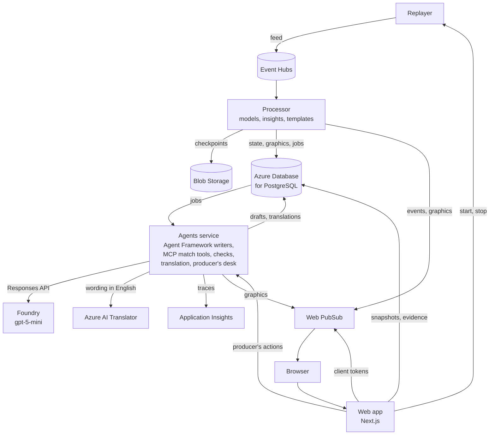

# Footnote

Explained match intelligence from synthetic football events: on-screen graphics
that explain each moment in a headline and a few lines of text. Entry to the
Microsoft Premier League Hackathon ("Inside the Game").

Video, 1:55: <https://youtu.be/rT6zPgLGF38>. Its footage is filmed from the
deployed demo.

**The football here is synthetic.** The league, clubs, players, officials and
matches are fictional and generated by code in this repository. No real match
events, footage, clubs, players or crests are used. Names were checked against
real people and clubs; see [docs/data.md](docs/data.md#names).

Who it's for and why: [docs/audience.md](docs/audience.md). What each viewer
sees: [docs/experience.md](docs/experience.md). Scope and done-list:
[SCOPE.md](SCOPE.md).

## Try it

The demo runs on Azure until judging ends on 10 November 2026, free and with no
sign-in: <https://ca-web-kwy7jucrk2pdm.whitepebble-d77f6eb9.westus3.azurecontainerapps.io>.
It replays the showcase match, Saltmarsh Rovers v Kingsferry Athletic, as if it
were live.

On the start page, pick who to watch as, where to start and the speed, then
**Start the replay**. A replay begins 30 seconds before the minute picked.
Starting as Nadia, the producer, leaves each graphic for her to approve; starting
as a fan approves graphics as they're found, and the console's **Approve
automatically** switch changes that either way. **Watch as**, above the match,
switches between the producer and the fans at any point. At 2×, each of these
takes a few minutes:

1. **23', as Nadia, the producer.** Kingsferry's goal reaches her shortlist with
   its rank and the reason for it. **Evidence** lists the events behind the
   graphic. **Agent runs** shows the agents' work on it: each MCP match tool
   called, the checks a draft failed, the time and tokens. Drafts are kept
   between replays, so the graphic usually arrives with an earlier replay's draft,
   marked "Agent, reused", and Agent runs shows the run that wrote it.
   **Redraft** asks the agents for a fresh one. **Approve** puts the graphic on
   air, with **Edit** and **Kill** beside it. Then switch to Sam, a fan whose
   stream runs 40 seconds behind live (20 seconds at 2×): the graphic reaches Sam
   with the goal, worded as Nadia approved it, or when she approves it if that
   comes later.
2. **31', as Tom, a blind fan.** The described feed tells the match in words for
   a screen reader, at the detail and pace set in **Settings**. Marco Dellow's
   goal is checked by VAR and ruled out for offside; switch to Sam for the
   decision's graphic, with a still of the pitch at the pass.
3. **60', as Lucía, joining late.** She reads what she missed in Spanish, then
   each graphic in Spanish once Azure AI Translator's version passes code's check;
   a graphic whose translation fails stays in English, marked as such. The next
   graphic, on a spell where neither side has control, comes about four minutes
   in at 2× (two at 4×).
4. **81', as Nadia.** The goal is first recorded as Jory Penhallow's own goal.
   At 84' the data provider credits it to Femi Adeyani: the graphics that cited it
   are flagged, and the restated graphic comes back to Nadia under **Corrections**
   with the correction notice. At full time the recap ends with a sentence from
   code on the change, whether an agent or the template wrote the rest.

The fifth profile, Priya, owns Teo Varlan in a fantasy league and watches in
analyst mode, focused on him, with pass difficulty pinned. A fan's **Settings**
change the mode, club, player in focus, pinned metric, language, stream delay,
calm mode, the pitch view and its graphics, and the described feed.

- A replay belongs to the browser that started it: only that browser approves
  its graphics or stops it, and starting another replaces it. Anyone with its link
  can watch.
- Up to six replays run at once; a seventh replaces the oldest.
- Each address can start eight replays in five minutes.
- A fresh draft (a graphic's first, or a Redraft) took 8 to 24 seconds in the
  recorded evaluation run ([docs/evaluations.md](docs/evaluations.md)), and
  Approve waits for it.

## How it runs



The four services run as container apps in one Azure Container Apps
environment and authenticate with managed identities, so no service uses a key
or password. What each one does, how a replay flows through them, the latency
measured on the deployed stack and the cost:
[docs/architecture.md](docs/architecture.md).

## What's built

- **The synthetic data generator.** It simulates a fictional league's matches
  from a hidden match-state model, produces an event feed with offside,
  handball and VAR decisions and provider-style corrections, 10 Hz player and
  ball tracking, and an answer key held apart from the feed. Two generated
  seasons are compared with published Premier League figures in
  [docs/calibration.md](docs/calibration.md). How it works and the feed's
  format: [docs/data.md](docs/data.md).
- **The live pipeline.** A replayer plays the showcase match into Azure Event
  Hubs, a stream processor on Azure Container Apps keeps each replay's match
  state in Azure Database for PostgreSQL and pushes each live event through
  Azure Web PubSub, and a Next.js web app shows the score, clock, stats and key
  moments as they arrive. A page whose connection is refused, or goes quiet
  while the replay plays on, follows by polling instead. How it fits together
  and what it costs: [docs/architecture.md](docs/architecture.md).
- **The models.** A pass-difficulty model and a live match-state model, fitted
  on generated matches and scored against the answer key on matches involving
  clubs whose playing styles they never saw: [docs/models.md](docs/models.md).
  The processor rates every pass except throw-ins, estimates the match state a
  few seconds behind play, and reads distance covered, top speeds and sprint
  and distance tags from the tracking; the live page shows them.
- **The insights and the agents.** The processor finds the moments worth a
  graphic, such as goals, VAR decisions, spells of pressure or chaos, hard passes,
  sprints and corrections from the provider. It ranks each from a base for its
  kind, raised by the match-state model (a goal against the run of play, a long
  spell) and by the moment's figures, and words each with a template. An agents
  service built with Microsoft Agent Framework on a Foundry model (gpt-5-mini)
  redrafts the ones where wording adds something. Its writers read the match
  only through our MCP match tools and put a placeholder where each figure
  goes, for code to fill in; code checks every draft and refuses one that types
  a figure. A draft that fails or comes late leaves the wording already on
  screen (the template's, or after a Redraft the earlier draft's), and the
  console says why. A recap writer tells the story of the match at half-time
  and full time, and writes the catch-up for a fan joining mid-match. How it
  works: [docs/insights.md](docs/insights.md), where a graphic's wording (its
  headline and its lines for casual fans and analysts) is called its card.
- **Evaluations of the agents.** The graphics the agents write in a replay from
  kick-off, and the catch-ups for the four jump points, are drafted on the
  deployed model and evaluated in code and with Azure AI Evaluation's
  groundedness evaluator; CI replays the recorded run through the current
  checks on each push to main and each pull request:
  [docs/evaluations.md](docs/evaluations.md).
- **Tracing.** Each graphic the agents draft is a trace in Application Insights,
  from the job through every model and tool call to the push, and so is each
  batch of translations:
  [docs/architecture.md](docs/architecture.md#tracing).
- **The producer console and the fan view.** Watch the replay as Nadia, the
  producer, or as one of the ready-made fans, and switch between them
  mid-match. The producer approves, edits, kills or withdraws each graphic, or lets
  them through automatically; an edit passes the same checks as an agent's
  draft, and what the producer approves is the wording they saw. A fan's stream
  runs a set delay behind live, and the page shows the match and its graphics as
  of that stream, so nothing shows before the fan's stream reaches it. Fans
  choose casual or analyst mode, their club, a player to follow and the figure
  to pin; calm mode turns off motion and flashing, and the pitch view can
  be hidden. On a desktop the match is drawn from the tracking on our own 2D
  pitch, standing in for the video; casual fans get a still of the pitch with
  each VAR decision, with the offside margin up close. What a graphic carries, and
  when it may show, is the overlay contract: [docs/overlay.md](docs/overlay.md).
- **Spanish and French.** The agents service has Azure AI Translator render each
  graphic fans see, with the names kept as they are, and code checks that every
  figure (minutes included), name and score line came through before a
  translation is shown; a graphic whose translation fails stays in English, marked
  as such.
- **The described feed.** Tom, a blind fan, follows the match in words: lines
  from templates over each event (where the ball is, the passes, the build-up,
  each graphic as it airs), spoken by the phone's screen reader at a chosen
  pace and detail, from key moments only to every pass, with a pause that
  catches up on resume.

Not built yet: a server-side store for viewer profiles. Settings are kept in the
browser.

Next steps, after the hackathon:

1. Testing with blind and partially sighted fans. The described feed hasn't
   been tried with them yet.
2. A women's league:
   - calibrate the generator to a women's league season's published figures;
   - set the thresholds tuned for the men's game (the fastest-shot graphic's
     100 km/h floor, the 10 km distance milestone) from that data;
   - fit the models again;
   - make the Spanish and French graphics agree with each player's gender, which
     the Translator can't tell from a name.

## Quick start

Needs Python 3.11 and [uv](https://docs.astral.sh/uv/); Node.js 24 for the web
app.

```sh
uv sync
uv run pytest -m "not slow"                      # tests, a minute or two
uv run python -m footnote.generator showcase     # rebuild the committed showcase match in data/
```

`tests/test_store.py` runs the SQL against a real Postgres and is skipped
unless `FOOTNOTE_TEST_DATABASE_URL` names one whose role may create databases,
for example `postgresql://postgres@127.0.0.1:5432/postgres`. CI runs it against
a Postgres 17 service.

`uv run python -m footnote.generator --help` lists the other commands: the
league, any single match, the full season and the feed's JSON Schema.

```sh
uv run python -m footnote.interpret --workers 8  # refit the models; rewrites their parameters and docs/models.md
```

Refitting generates the whole season in memory, so it takes a while (the run
time is in [docs/models.md](docs/models.md)). The services load the fitted
parameters committed in `src/footnote/interpret/params/`.

```sh
uv run python -m footnote.evals replay           # the agents' recorded output through today's checks, as CI runs it
uv run --group evals python -m footnote.evals live --record --report   # draft and judge again on Foundry
```

A live evaluation needs `FOUNDRY_PROJECT_ENDPOINT` and `FOUNDRY_MODEL` from
`azd env get-values` and an Azure CLI sign-in as the account that ran `azd up`:
azd fills `AZURE_PRINCIPAL_ID` with that account, and the Bicep gives it the
roles local development needs, Foundry User among them
([docs/architecture.md](docs/architecture.md#identity-and-access)). Run it
after changing the agents' instructions, tools or workflow: until the recording
matches them, CI fails.

## Deploying to Azure

Needs the [Azure Developer CLI](https://aka.ms/azd) 1.36 or later (the version
this was deployed with) and the Azure CLI, both signed in to the subscription
(`azd auth login` and `az login`) with the right to create resources and assign
roles (Owner, or Contributor with User Access Administrator): the Bicep gives
each service its roles. Register the resource providers the Bicep uses, once
per subscription:

```sh
for p in Microsoft.App Microsoft.ContainerRegistry Microsoft.EventHub Microsoft.DBforPostgreSQL \
         Microsoft.SignalRService Microsoft.Storage Microsoft.OperationalInsights Microsoft.Insights \
         Microsoft.ManagedIdentity Microsoft.CognitiveServices; do
  az provider register --namespace "$p"
done
```

Then:

```sh
azd env new footnote
azd env set AZURE_LOCATION westus3
azd up
```

`azd up` provisions [infra/main.bicep](infra/main.bicep), including a Foundry
project with a Global Standard deployment of gpt-5-mini (the subscription needs
100K tokens a minute of that model's quota), builds the four images in the
container registry (no local Docker needed, except on a subscription running on
free credits, where the registry's builds are paused) and deploys each container
app from `infra/<service>.bicep`, the processor first: it creates the other
services' database roles. It prints the web app's URL. The demo's stack was built
up from this Bicep over 19–21 October. A fresh `azd up` into an empty
environment on the same subscription, on 23 October, stopped at two refusals
from Azure: the model deployment in the new Foundry account (error 715-123420,
"unusual activity") and the Postgres server in westus3 ("SkuNotAvailable",
though `az postgres flexible-server list-skus` offers Standard_B1ms there). On
another subscription or in another region either may go through. To check the
deployed pipeline end to end, as a browser would follow it:

```sh
uv run python scripts/smoke_live.py <web app URL> --minute 81 --speed 4
```

[live-check.yml](.github/workflows/live-check.yml) runs the same check on the demo once a day, with
the web app's URL in the repository variable `DEMO_URL`.

Settings to make with `azd env set` before `azd up`, or before a later
`azd provision`:

- `TRANSLATOR_ENABLED true` adds Azure AI Translator on its free tier for the
  graphics in Spanish and French; without it the graphics stay in English.
- `TRANSLATOR_SKU S1` picks the Standard tier, billed by the character, for a
  subscription that already has its one free Translator.
- `WEBPUBSUB_SKU` is `Free_F1` by default: 20 connections and 20,000 messages a
  day. `Standard_S1` raises both and bills the messages past a million a day.
- `DEPLOY_WRITER_MODEL false` leaves the model deployment out of later
  provisions. On this project's subscription, Azure refused to submit the
  existing deployment again, even unchanged (error 715-123420, "unusual
  activity").
- `AZURE_PRINCIPAL_NAME <your sign-in name>` makes you a Postgres administrator,
  for local development.
- `CLIENT_IP_ADDRESS <your public IP>` lets your machine through the Postgres
  firewall, for local development.

The four container apps each keep a replica running. `azd down --purge` deletes
the lot, purging the resources Azure keeps after deletion, such as the Foundry
and Translator accounts.

## Local development

The services run locally against the resources `azd up` created, signed in as
you through the Azure CLI. The replayer is reachable only inside Azure, so run
it locally too. Settings come from `azd env get-values`.

```sh
# The replayer: EVENTHUB_NAMESPACE and EVENTHUB_NAME
uv run python -m footnote.replayer               # http://localhost:8000

# The agents service, with the producer's desk on http://localhost:8080:
# FOUNDRY_PROJECT_ENDPOINT, FOUNDRY_MODEL, WEBPUBSUB_ENDPOINT, WEBPUBSUB_HUB,
# POSTGRES_HOST, POSTGRES_DATABASE, and POSTGRES_USER set to your sign-in name
# (needs AZURE_PRINCIPAL_NAME above); TRANSLATOR_ENDPOINT translates the graphics
# and APPLICATIONINSIGHTS_CONNECTION_STRING traces them, when set. Stop the
# deployed one first, or the two share the jobs.
uv run python -m footnote.agents

# The web app: frontend/.env.local with REPLAYER_URL=http://localhost:8000,
# DESK_URL=http://localhost:8080, WEBPUBSUB_ENDPOINT, WEBPUBSUB_HUB,
# POSTGRES_HOST, POSTGRES_DATABASE, and POSTGRES_USER set to your sign-in name
# (needs AZURE_PRINCIPAL_NAME above); POSTGRES_PORT if it isn't 5432
cd frontend && npm ci && npm run dev             # http://localhost:3000
```

The deployed processor picks up runs started locally. Checks for the web app:
`npm run lint`, `npm run typecheck`, `npm test`, `npm run build`.

## Layout

```text
src/footnote/generator/   league, match simulation, officials, feed, tracking, showcase search
src/footnote/calibration/ published targets and the calibration report
src/footnote/interpret/   pass difficulty, the match-state model, distances and tags; their training and report
src/footnote/live/        shared by the services: the match files, replay time, stats, analysis, state, contracts, the overlay contract, the pitch view's tracking
src/footnote/replayer/    plays the showcase feed into Event Hubs, one run per replay
src/footnote/processor/   Event Hubs to match state, insights, Postgres and Web PubSub
src/footnote/insights/    moments found and ranked, facts, templates, the checks every graphic passes
src/footnote/tools/       the match tools: an MCP server answering as of one moment of one run
src/footnote/agents/      the agents service: the Agent Framework writers, their checks, the job loop, the translation worker, the producer's desk
src/footnote/evals/       the agents' evaluations: every agent job in the showcase, code evaluators, the groundedness judge, the report
src/footnote/db/          Entra-authenticated Postgres connections, migrations and roles
src/footnote/cloud.py     the services' Azure credentials and settings
src/footnote/telemetry.py the agents service's traces to Application Insights
frontend/                 the Next.js web app (fan view, producer console, 2D pitch), with its Vitest tests beside the code
infra/                    Bicep: main.bicep, the shared resources in resources.bicep and modules/, and one file per container app
scripts/check_names.py    checks every generated name against Wikidata
scripts/smoke_live.py     follows a replay on the deployed stack: completeness, order, final state, stored pushes, tracking, latency
tests/                    contract, consistency, physics, story, calibration, model, replay, processing, insight, agent, evaluation and SQL checks
data/                     generated output; git keeps the league, the showcase match, both answer keys, the recipe, the name check and the agents' recorded evaluation run
docs/                     audience, experience, data, calibration, models, insights, evaluations, the overlay contract and its schema, architecture
.github/workflows/        CI: lint, type checks, tests (with a Postgres and the agents' evaluations), the web build and the Bicep, on pushes to main and on pull requests; the live check, once a day
```

## Licence

Copyright (c) 2026 Cesaire Tobias. All rights reserved. The code is public so the hackathon can
judge it, and that gives no right to use it: see [LICENSE](LICENSE). Entering the hackathon grants
Microsoft and the Premier League the licence in section 7 of its official rules. Code from other
projects keeps its own licence: [THIRD_PARTY_NOTICES.md](THIRD_PARTY_NOTICES.md).
